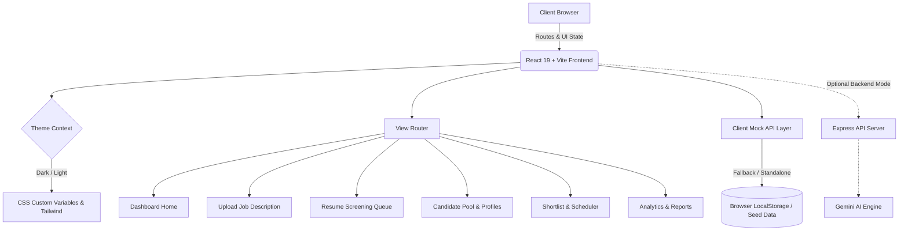

# SmartCV Screening AI — Intelligent Resume Matcher & ATS Ranking Platform

<div align="center">

[](https://smartcv-screening-ai.netlify.app)
[](LICENSE)
[](https://react.dev/)
[](https://www.typescriptlang.org/)
[](https://vitejs.dev/)
[](https://tailwindcss.com/)

**SmartCV Screening AI** is an enterprise-grade AI recruiting intelligence platform that automates resume screening, scores candidates against Job Descriptions with multi-dimensional ATS metrics, visualizes talent fit with interactive radar charts, and streamlines recruiter workflows.

[🚀 Explore Live Demo](https://smartcv-screening-ai.netlify.app) • [📖 Documentation](#table-of-contents) • [✨ Key Features](#key-features) • [🛠️ Tech Stack](#tech-stack)

</div>

---

## 📑 Table of Contents

- [🌟 Live Application](#-live-application)
- [✨ Key Features](#-key-features)
- [🌓 Theme Engine (Dark & Light Mode)](#-theme-engine-dark--light-mode)
- [📱 Responsive Design Architecture](#-responsive-design-architecture)
- [🏗️ System Architecture](#️-system-architecture)
- [🛠️ Tech Stack](#️-tech-stack)
- [📂 Project Structure](#-project-structure)
- [🚀 Quick Start & Installation](#-quick-start--installation)
- [🌐 Deployment](#-deployment)
- [🤝 Contributing](#-contributing)
- [📄 License](#-license)

---

## 🌟 Live Application

The project is deployed and live on Netlify with automated continuous deployment and SPA client routing:

🔗 **Production URL**: [https://smartcv-screening-ai.netlify.app](https://smartcv-screening-ai.netlify.app)  
📦 **GitHub Repository**: [https://github.com/hasim2006/smartcv-screening](https://github.com/hasim2006/smartcv-screening)

---

## ✨ Key Features

### 1. 🤖 AI-Powered Resume & JD Matching
- Analyzes candidate resumes against target Job Descriptions using multi-factor ATS criteria.
- Computes granular scores: **Overall ATS Match**, **Technical Skills Match**, **Experience Fit**, **Education Rating**, and **Soft Skills / Culture Alignment**.
- Generates pros, cons, keyword gaps, and interview recommendations for each candidate.

### 2. 🌓 Bespoke Dark & Light Mode
- Seamless theme switching with instant persistence in `localStorage`.
- System preference (`prefers-color-scheme`) auto-detection.
- Semantic CSS tokens (`--bg-app`, `--bg-card`, `--border-main`, `--text-main`, `--text-muted`, etc.) ensuring high contrast, accessibility, and zero flicker across both modes.

### 3. 📱 100% Fully Responsive Layout
- **Mobile First**: Sliding off-canvas navigation drawer with backdrop blur on mobile/tablet viewports (`< 1024px`).
- **Adaptive Metrics Grid**: KPI metric cards scale dynamically from single column on small screens to 6-column widescreen dashboards.
- **Scrollable Data Tables**: Responsive table wrappers with sticky headers and responsive candidate avatars.
- **Deep-Dive Candidate Drawer**: Fluid sliding panel (from full screen on mobile to 900px modal on desktop) featuring SVG skill radar charts and tabbed profiles.

### 4. 📊 Talent Analytics & Visualization
- Interactive candidate funnel visualizations.
- Department hiring distributions and top in-demand skills radar charts.
- Experience vs. Match percentage scatter plots with dynamic Recharts tooltips adapted for both light and dark themes.

### 5. 📑 Comprehensive Recruitment Pipeline
- **Upload JD View**: Instant parsing of job requirements, role titles, and minimum experience thresholds.
- **Batch Resume Screening**: Drag-and-drop file ingestion supporting PDF, DOCX, and text formats.
- **Candidate Shortlist & Interview Scheduler**: Filter, star, and schedule 1-on-1 interviews with automated calendar reminders.
- **Report & Data Export Center**: Instant download of recruitment summaries and candidate dossiers in CSV, JSON, and PDF formats.

---

## 🌓 Theme Engine (Dark & Light Mode)

The application utilizes a custom `ThemeContext` backed by CSS Custom Properties and Tailwind color mapping:

```tsx
// src/context/ThemeContext.tsx
const { theme, toggleTheme, setTheme } = useTheme();
```

### Color Token Palette

| Token | Light Mode | Dark Mode | Usage |
| :--- | :--- | :--- | :--- |
| `--bg-app` | `#F8FAFC` (Slate 50) | `#070B14` (Deep Space) | Main app canvas background |
| `--bg-card` | `#FFFFFF` (Pure White) | `#0D1527` (Navy Midnight) | Cards, panels, modals |
| `--border-main` | `#E2E8F0` (Slate 200) | `rgba(255,255,255,0.08)` | Subtle card dividers & borders |
| `--text-main` | `#0F172A` (Slate 900) | `#F8FAFC` (Slate 50) | Primary headers & labels |
| `--text-muted` | `#64748B` (Slate 500) | `#94A3B8` (Slate 400) | Secondary captions & subtext |

---

## 📱 Responsive Design Architecture

The interface adapts gracefully across all screen breakpoints:

- **Mobile Viewports (`< 640px`)**:
  - Off-canvas hamburger menu drawer with smooth CSS transitions.
  - Compact search bar with modal query expander.
  - Tabbed sub-navigation with horizontal swipe scrolling.
  - Full-width stacked forms and candidate action sheets.

- **Tablet Viewports (`640px - 1023px`)**:
  - Two-to-three column grid distribution for dashboard metric cards.
  - Split view for JD analysis and candidate scoring.
  - Semi-expanded candidate profile viewer.

- **Desktop & Ultra-Wide (`1024px+`)**:
  - Persistent sleek sidebar with quick-access badges.
  - Full multi-column analytical dashboard with synchronized charts.
  - Side-by-side resume preview and ATS scoring matrix.

---

## 🏗️ System Architecture



---

## 🛠️ Tech Stack

| Domain | Technology | Description |
| :--- | :--- | :--- |
| **Frontend Framework** | React 19 (`^19.0.0`) | Modern component architecture with hooks |
| **Language** | TypeScript (`^5.8.2`) | Strict type safety across all candidate & JD interfaces |
| **Bundler & Dev Server**| Vite (`^6.2.0`) | Lightning fast HMR and optimized production bundling |
| **Styling** | Tailwind CSS + Vanilla CSS Variables | Responsive utility system with dynamic theme variables |
| **Icons** | Lucide React | High-performance, consistent SVG icon set |
| **Charts & Metrics** | Recharts & SVG Radars | Reactive, theme-aware analytical charts |
| **Hosting & CI/CD** | Netlify | Static SPA deployment with automated redirects |

---

## 📂 Project Structure

```
smartcv-screening/
├── public/
│   ├── _redirects            # Netlify SPA redirect rules
│   └── favicon.ico
├── src/
│   ├── components/
│   │   ├── AnalyticsView.tsx    # Interactive hiring analytics & charts
│   │   ├── CandidateProfile.tsx # Detailed candidate drawer & radar score
│   │   ├── Candidates.tsx       # Searchable candidate table with filters
│   │   ├── DashboardHome.tsx    # Metric KPIs, active jobs, recent candidates
│   │   ├── ReportsView.tsx      # Exportable executive recruitment briefs
│   │   ├── ResumeScreening.tsx  # Batch CV drag-and-drop upload & processing
│   │   ├── SettingsView.tsx     # Theme, AI model, and account preferences
│   │   ├── ShortlistView.tsx    # Shortlist management & interview scheduler
│   │   ├── Sidebar.tsx          # Responsive off-canvas navigation bar
│   │   ├── TopBar.tsx           # Global search, theme switcher, user menu
│   │   └── UploadJD.tsx         # Job Description parser & requirement builder
│   ├── context/
│   │   └── ThemeContext.tsx     # Dark/Light mode state management & hook
│   ├── utils/
│   │   └── clientMockApi.ts     # Standalone resilience mock API layer
│   ├── App.tsx                  # Root app layout & responsive wrappers
│   ├── index.css                # Global theme tokens, scrollbars, animations
│   ├── main.tsx                 # React DOM mount point & initializers
│   └── types.ts                 # TypeScript types for candidates, JDs, scores
├── dist/                        # Production build artifacts
├── netlify.toml                 # Netlify deployment configuration
├── package.json                 # Project dependencies & scripts
├── tailwind.config.js           # Tailwind color palettes & container rules
├── tsconfig.json                # TypeScript compiler configuration
└── vite.config.ts               # Vite bundler plugins & alias mappings
```

---

## 🚀 Quick Start & Installation

### Prerequisites
- Node.js (version 18.x or 20.x recommended)
- npm or pnpm

### 1. Clone the Repository
```bash
git clone https://github.com/hasim2006/smartcv-screening.git
cd smartcv-screening
```

### 2. Install Dependencies
```bash
npm install
```

### 3. Configure Environment Variables (Optional)
Create a `.env` or `.env.local` file in the root directory if connecting to Gemini AI directly:
```env
GEMINI_API_KEY=your_google_gemini_api_key_here
PORT=3000
```

### 4. Run Development Server
```bash
npm run dev
```
Open [http://localhost:3000](http://localhost:3000) in your browser to view the application.

### 5. Build for Production
```bash
npm run build
```
The optimized build output will be generated in the `dist/` directory.

---

## 🌐 Deployment

### Deploying to Netlify
1. Fork or clone this repository to GitHub.
2. Log into [Netlify](https://app.netlify.com).
3. Select **Add new site** > **Import an existing project**.
4. Set **Build command**: `npm run build`
5. Set **Publish directory**: `dist`
6. Click **Deploy Site**!

*Note: The included `public/_redirects` ensures all client-side routes redirect seamlessly to `index.html`.*

---

## 🤝 Contributing

Contributions, issues, and feature requests are welcome!

1. Fork the repository (`https://github.com/hasim2006/smartcv-screening/fork`)
2. Create your feature branch (`git checkout -b feature/AmazingFeature`)
3. Commit your changes (`git commit -m 'feat: Add some AmazingFeature'`)
4. Push to the branch (`git push origin feature/AmazingFeature`)
5. Open a Pull Request

---

## 📄 License

This project is licensed under the MIT License — see the [LICENSE](LICENSE) file for details.

---

<div align="center">
Developed with ❤️ by <a href="https://github.com/hasim2006">Mohammad Hasim</a>
</div>
